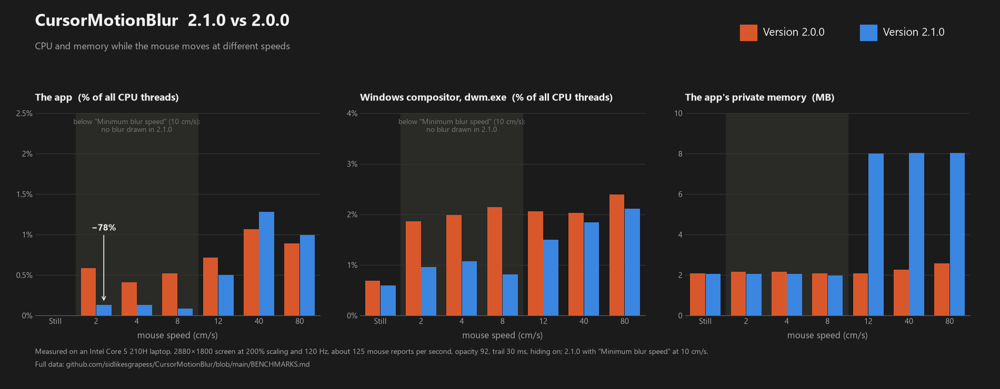
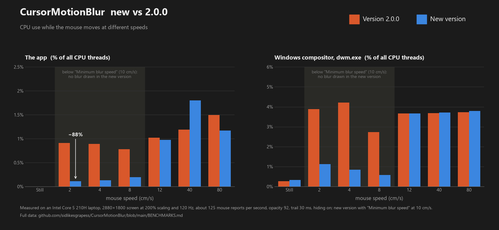

# CursorMotionBlur: CPU and RAM

## 2.1.0 vs 2.0.0

Measured 2026-11-05, both versions one after the other with the same settings as below (opacity 92, trail 30 ms, hiding
on; 2.1.0 with "Minimum blur speed" at 10 cm/s). Same laptop and method; dwm.exe was read from its performance counter
(`\Process(dwm)\% Processor Time`), as the script ran without administrator rights.

| Speed | App 2.0.0 | App 2.1.0 | dwm 2.0.0 | dwm 2.1.0 | Private RAM 2.0.0 | Private RAM 2.1.0 |
|---|---|---|---|---|---|---|
| Still | 0.00% | 0.00% | 0.69% | 0.60% | 2.1 MB | 2.1 MB |
| 2 cm/s | 0.59% | 0.13% | 1.86% | 0.96% | 2.2 MB | 2.1 MB |
| 4 cm/s | 0.41% | 0.13% | 1.99% | 1.07% | 2.2 MB | 2.1 MB |
| 8 cm/s | 0.52% | 0.09% | 2.15% | 0.81% | 2.1 MB | 2.0 MB |
| 12 cm/s | 0.72% | 0.50% | 2.06% | 1.50% | 2.1 MB | 8.0 MB |
| 40 cm/s | 1.06% | 1.28% | 2.03% | 1.84% | 2.3 MB | 8.0 MB |
| 80 cm/s | 0.89% | 1.00% | 2.40% | 2.12% | 2.6 MB | 8.0 MB |

The working set was 12-13 MB for 2.0.0 and 12 MB for 2.1.0 (23 MB while the blur is drawn).

- Below the minimum blur speed 2.1.0 draws nothing: about 78% less CPU for the app, and dwm about halves.
- Above it the app costs about the same; a second run of 2.1.0 read 0.67%, 1.06% and 1.21% at 12, 40 and 80 cm/s, so a
  few tenths either way is noise. dwm is a little lower, as only the changed part of the window is sent each frame.
- 2.1.0 holds about 8 MB while the blur is drawn: its window stays put while the pointer is still (so apps under it,
  such as Office menus, don't flicker), and is larger than the blur. It gives the memory back 1.5 s after the mouse
  stops; the "Still" row and the tests in `tools/modtest` show it back at 2 MB.

## Before 2.1.0 vs 2.0.0

Measured 2026-10-14. The app as it was in v2.0.0 against the current build, one after the other, with the same settings
(opacity 92, trail 30 ms, hiding on); the new one with "Minimum blur speed" at 10 cm/s (about 960 px/s on this screen).

**Setup:** Intel Core 5 210H laptop, screen 2880x1800 at 200% scaling and 120 Hz, 12 logical CPUs. The mouse moved in
circles of 400 px radius for 6 s per speed, with input injected at about 125 reports per second. CPU is % of all 12
logical CPUs. Script: `tools/speedcpu.py app --cm=2,4,8,12,40,80`, image: `tools/make-benchmark.py`.

| Speed | App 2.0.0 | App new | dwm 2.0.0 | dwm new | Private RAM 2.0.0 | Private RAM new |
|---|---|---|---|---|---|---|
| Still | 0.00% | 0.00% | 0.26% | 0.33% | 2.0 MB | 2.0 MB |
| 2 cm/s | 0.91% | 0.11% | 3.88% | 1.13% | 2.0 MB | 2.0 MB |
| 4 cm/s | 0.89% | 0.13% | 4.21% | 0.85% | 2.5 MB | 2.0 MB |
| 8 cm/s | 0.78% | 0.20% | 2.73% | 0.59% | 2.0 MB | 2.0 MB |
| 12 cm/s | 1.02% | 0.97% | 3.66% | 3.66% | 2.9 MB | 2.9 MB |
| 40 cm/s | 1.19% | 1.80% | 3.69% | 3.71% | 2.9 MB | 2.9 MB |
| 80 cm/s | 1.50% | 1.17% | 3.73% | 3.80% | 2.9 MB | 2.9 MB |

The working set (including shared system DLL pages) was 11-12 MB for both.

The 8 cm/s row was measured again on its own: the first run jumped the pointer 400 px to the circle's edge before each
speed, and that jump turned the blur on (it stays on above half the minimum speed, 5 cm/s). The script now starts the
circle where the pointer already is. The other rows are from the first run; the jump doesn't matter for them (2 and 4 cm/s
are under half the minimum speed, 12 cm/s and up are over it).

- The saving is below the minimum blur speed: no blur is drawn there, so the app and the compositor stay almost idle.
- Above it the two versions cost about the same. Run-to-run noise on the moving rows is a few tenths of a percent
  (the 40 cm/s result for the new build is one such run; an earlier run of the same build read 1.5% at 4000 px/s).
- Another run with the new defaults (opacity 50, minimum speed 29 cm/s, trail 30 ms) gave 0.00% still, 0.09% at 500 px/s,
  1.1% at 1500 px/s, 1.9% at 4000 px/s and 1.6% at 8000 px/s.

