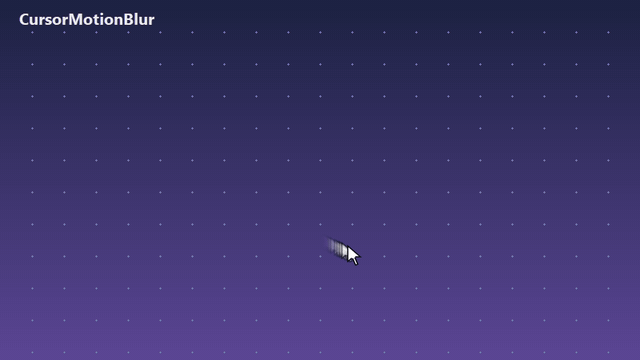
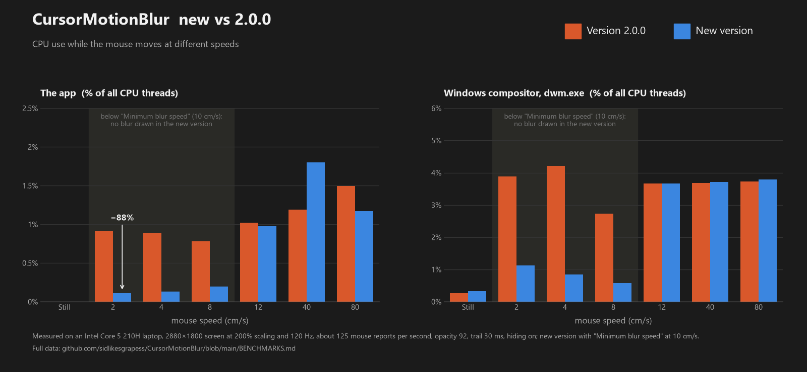

# CursorMotionBlur

A tiny, portable Windows tray app that adds a **live motion blur to your mouse cursor**, system-wide, like macOS.




> # The blur CAN NOT show above the Start menu!!!!
> **Start menu,nottification center etc. sit on a higher layer** I would have to get a signed cetificate (costs money) or use some hacky method to make this work. 1. Im lazy. 2. Its risky + I wouldnt trust a random guy on the internet just for a mouse effect  
> Still want it? Use the **Pointer Afterimage Motion Blur** mod for [windhawk](https://windhawk.net/mods/pointer-afterimage-motion-blur) instead. It can draw above them. Don't run both at once, they fight over the cursors.


## Using it

1. Grab `CursorMotionBlur.exe` from [Releases](../../releases) and run it.
2. A settings window opens (check tray if it doesnt).
3. It lives in the tray after closing. Right-click for **Enabled / Settings / Exit**, or hit **Ctrl+Alt+B** to toggle (changeable in Settings).

| Setting | What it does |
| --- | --- |
| Trail opacity | How solid the blur is right behind the pointer (1-100%) |
| Minimum blur speed | No blur below this pointer speed, in cm/s on your main monitor (0-50, 0 = always blur) |
| Trail length | How far back in time the blur reaches (10-150 ms) |
| Hide the real cursor when fast | Swaps in an invisible cursor above this speed (cm/s on your main monitor, same hand speed on every screen) |
| Toggle hotkey | Global on/off shortcut. Needs Ctrl, Alt or Shift |
| Pause in fullscreen | No blur while a fullscreen app or game is in front |
| Launch when Windows starts | Per-user startup entry |
| Check for updates | Only asks GitHub when you click. The app never goes online on its own |

Settings live in `%APPDATA%\CursorMotionBlur\settings.ini`.

**Cursor stuck invisible?** It restores your cursors on exit and on crash, and on the next start if it got killed while they were hidden. Otherwise just run the exe again, or open *Mouse > Pointers* in Windows settings and click OK.

## Known limits

- **No blur on top of Start, Search, notifications and other shell things.** The overlay is a normal window and Windows keeps those in a higher layer, so the blur goes underneath them. See the notice at the top.
- **The blur lags a fram or two behind the pointer.** Windows draws the real pointer last, but any normal window shows up one or two refreshes later. At 30-45 cm/s the gap is about 1.5 pointer widths. That's why "hide when fast" exists.

## Stats

Nothing at all while the mouse is still, about 1% of the CPU while it moves, about 2-3 MB of private memory. Below the minimum blur speed it stays almost idle ([numbers](BENCHMARKS.md)).



## Build

Needs [llvm-mingw](https://github.com/mstorsjo/llvm-mingw) on PATH (`winget install MartinStorsjo.LLVM-MinGW.UCRT`):

```powershell
powershell -ExecutionPolicy Bypass -File build.ps1
```

You get `dist\CursorMotionBlur.exe`. Set `CMB_DEBUG=1` to get a log in `%TEMP%\CursorMotionBlur.log`. It's plain C and Win32: `main.c` (tray, hotkey, settings), `engine.c` (cursor path, hiding, blur copies), `render.c` (drawing), `ui.c` (settings window).

## License

Public domain ([Unlicense](LICENSE)). Do whatever you want with it.
